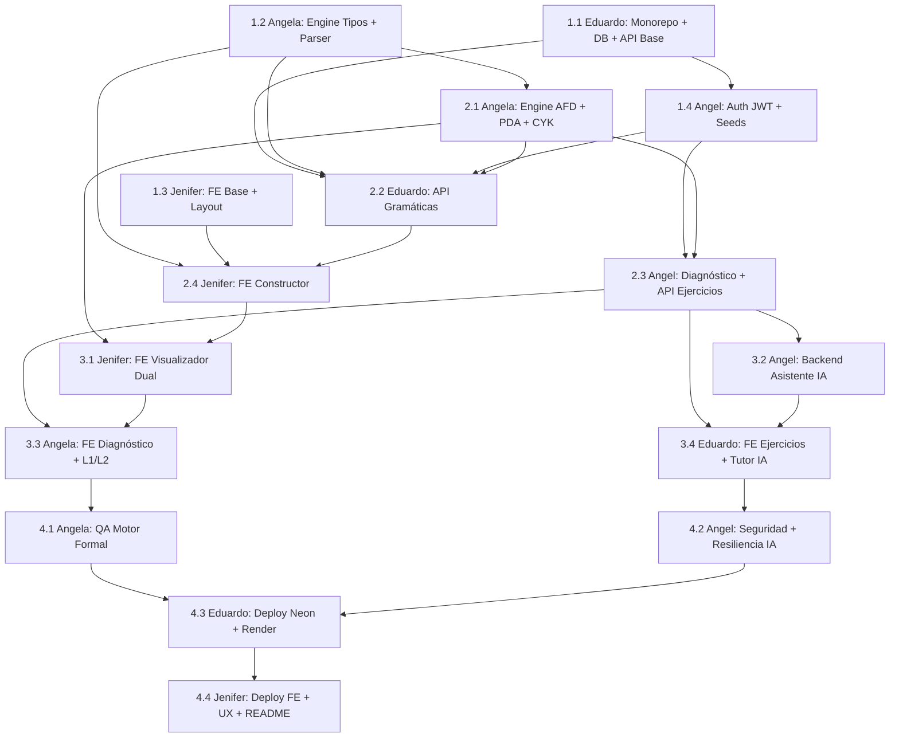

# plan.md — Plan de Desarrollo por Fases y Reparto del Equipo

> **Tablero vivo del proyecto GrammaLab.** Divide la construcción completa del sistema en **4 Fases y 16 Subfases** repartidas equitativamente (**4 subfases por integrante**, 1 por fase) con fronteras claras para minimizar conflictos en Git.

**Leyenda de estados:**
- `[ ]` Pendiente
- `[/]` En progreso
- `[x]` Completada y verificada

---

## 1. Resumen de Carga de Trabajo (Equitativa 4 × 4)

| Integrante | Cuenta | Fase 1 | Fase 2 | Fase 3 | Fase 4 | Total |
| :--- | :--- | :--- | :--- | :--- | :--- | :---: |
| **Eduardo Valenzuela** | `20231001440` | `1.1` Monorepo, Docker DB y NestJS/Prisma | `2.2` API de Gramáticas y Simulación | `3.4` FE Ejercicios + Panel Tutor IA | `4.3` Deploy Neon (DB) + Render (API) | **4** |
| **Angela Baires** | `20241900129` | `1.2` Engine: Tipos, Parser y Validador | `2.1` Engine: AFD, PDA y FNC/CYK | `3.3` FE Diagnóstico + Comparativa $L_1$/$L_2$ | `4.1` QA Integral del Motor Formal | **4** |
| **Angel Castillo** | `20251900173` | `1.4` Auth JWT y Seeds PostgreSQL | `2.3` Diagnóstico/Generador + API Ejercicios | `3.2` Backend Asistente IA (Gemini/Groq) | `4.2` Seguridad API y Resiliencia IA | **4** |
| **Jenifer Padilla** | `20241900042` | `1.3` FE Base (React/Vite/Tailwind) y Layout | `2.4` FE Auth, Biblioteca y Constructor | `3.1` FE Visualizador Dual (AFD/PDA/CYK) | `4.4` Deploy FE, Pulido UX y `README.md` | **4** |

---

## 2. Mapa de Dependencias entre Subfases

---

## 3. Detalle de Fases y Subfases

### FASE 1: Cimientos del Monorepo, Base de Datos y Contratos Base
*Meta: Tener el monorepo listo para compilar, PostgreSQL 17 operativo (Docker o local), esquema Prisma migrado, tipos/parser base del motor formal, esqueleto del frontend y autenticación + datos semilla.*

- [x] **Subfase 1.1 — Inicialización del Monorepo, PostgreSQL 17 (Docker opcional) y NestJS + Prisma Base**
  - **Responsable:** Eduardo Valenzuela (`20231001440`)
  - **Depende de:** Ninguna
  - **Alcance / Carpeta principal:** `package.json` raíz, `.gitignore`, `docker-compose.yml`, `apps/api/prisma/schema.prisma`, `apps/api/src/{prisma,health,common,app.module.ts,main.ts}`, `apps/api/.env.example`.
  - **Entregables:**
    - Configurar `npm workspaces` (`packages/*`, `apps/*`) y scripts raíz (`db:up`, `db:down`, `db:migrate`, `db:seed`, `dev:api`, `dev:web`, `dev`, `build`, `test`, `typecheck`).
    - Crear `docker-compose.yml` **únicamente** con `postgres:17-alpine`, volumen persistente y `healthcheck`.
    - Inicializar `apps/api` (NestJS + TypeScript strict + `ValidationPipe` global + CORS por `CORS_ORIGIN` + prefijo `/api`).
    - Definir `schema.prisma` completo (`users`, `grammars`, `exercises`, `exercise_attempts`, `ai_interactions`), generar migración inicial y exponer `GET /api/health` verificando conectividad real a PostgreSQL.
    - Documentar en `apps/api/.env.example` la configuración tanto para Docker como para PostgreSQL 17 local.
  - **Criterios de aceptación (DoD):** `apps/api` arranca en host local contra PostgreSQL 17 (Docker o local), `prisma migrate dev` corre limpio y `GET /api/health` responde `200 OK` con `{ status: "ok", db: "connected" }`.

- [ ] **Subfase 1.2 — Paquete Compartido `@grammalab/formal-engine`: Tipos, Parser, Validador y Clasificador**
  - **Responsable:** Angela Baires (`20241900129`)
  - **Depende de:** Ninguna *(puede iniciar en paralelo a 1.1; al fusionar se vincula a `npm workspaces`)*
  - **Alcance / Carpeta principal:** `packages/formal-engine/src/{types,parser,index.ts}` + tests Vitest.
  - **Entregables:**
    - Definir interfaces compartidas de `Grammar`, `Production`, `GrammarValidationResult`, `ChomskyType`, `SimulationStep`, `SimulationResult`, `DiagnosticResult`, `ExercisePayload` y `EvaluationResult`.
    - Implementar parser de producciones desde texto (`S -> aSb | ε`, soportando `ε`, `lambda`, `''`) y constructor estructurado.
    - Implementar validador formal ($V \cap \Sigma = \emptyset$, $S \in V$, símbolos declarados, símbolos inalcanzables/improductivos) y clasificador estructural (**Tipo 3 Regular** lineal derecha/izquierda vs. **Tipo 2 Libre de Contexto** indicando qué reglas rompen regularidad).
    - Escribir batería inicial de tests unitarios en Vitest.
  - **Criterios de aceptación (DoD):** El paquete compila sin dependencias externas de UI/backend y todos los tests unitarios de parser, validación y clasificación pasan.

- [x] **Subfase 1.3 — Inicialización del Frontend (`apps/web`: React + Vite + Tailwind) y Layout Base**
  - **Responsable:** Jenifer Padilla (`20241900042`)
  - **Depende de:** Ninguna *(puede iniciar en paralelo a 1.1)*
  - **Alcance / Carpeta principal:** `apps/web/src/{api,context,components,pages,App.tsx,main.tsx}`, `apps/web/.env.example`.
  - **Entregables:**
    - Inicializar `apps/web` con Vite + React + TypeScript + Tailwind CSS + `react-router-dom`.
    - Implementar cliente HTTP tipado (`src/api/client.ts`) apuntando a `VITE_API_URL`, adjuntando JWT si existe y detectando respuestas lentas (*cold start* de Render).
    - Crear `SessionContext` soportando **modo invitado** (`sessionKey` persistente + `localStorage`) y **usuario autenticado**.
    - Crear layout principal responsivo, navegación entre secciones (*Inicio / Comparativa*, *Constructor*, *Simulador*, *Ejercicios*), manejo de errores y banner de estado del servidor (`/api/health`).
  - **Criterios de aceptación (DoD):** `apps/web` arranca en `http://localhost:5173`, navega entre rutas base, compila con `npm run build` sin errores de tipos y muestra el estado de conexión con la API.

- [ ] **Subfase 1.4 — Autenticación Ligera (JWT) y Seeds Oficiales en PostgreSQL**
  - **Responsable:** Angel Castillo (`20251900173`)
  - **Depende de:** `1.1`
  - **Alcance / Carpeta principal:** `apps/api/src/auth/*`, `apps/api/prisma/seed.ts`.
  - **Entregables:**
    - Implementar `POST /api/auth/register`, `POST /api/auth/login` y `GET /api/auth/me` con `bcrypt`, `@nestjs/jwt`, `JwtAuthGuard` y `OptionalJwtAuthGuard`.
    - Crear `apps/api/prisma/seed.ts` **idempotente** que cargue plantillas oficiales de gramáticas y ejercicios en los 3 niveles:
      - $L_1$: cadenas sobre $\{a, b\}$ terminadas en `ab` (Regular).
      - $L_2$: paréntesis balanceados $\{ (^n )^n \mid n \ge 0 \}$ (Libre de Contexto).
      - Ejemplos adicionales: $a^n b^n$, identificadores regulares, palíndromos simples y expresiones aritméticas básicas.
  - **Criterios de aceptación (DoD):** Registro/login/me funcionan con validación DTO, nunca exponen `passwordHash`, y `npm run db:seed` puede ejecutarse 2 veces seguidas sin duplicar registros.

---

### FASE 2: Motor Formal Completo y API Core
*Meta: Completar el núcleo algorítmico (AFD, PDA, CYK, diagnósticos y generador), exponer los endpoints de gramáticas y ejercicios en NestJS, y construir el editor/biblioteca en el frontend.*

- [ ] **Subfase 2.1 — Motor Dual Completo: Reconocedor Regular (AFD) y Libre de Contexto (PDA + FNC/CYK)**
  - **Responsable:** Angela Baires (`20241900129`)
  - **Depende de:** `1.2`
  - **Alcance / Carpeta principal:** `packages/formal-engine/src/{dfa,pda,cyk}/*` + tests Vitest.
  - **Entregables:**
    - **Módulo AFD:** Conversión de gramática regular lineal derecha $\rightarrow$ AFN-$\varepsilon$ $\rightarrow$ AFD (subconjuntos), soporte de definición directa de AFD, y simulador paso a paso retornando grafo (`nodes`, `edges`) y traza completa.
    - **Módulo PDA:** Simulador paso a paso (cinta, estado, pila con operaciones `push`/`pop`/`noop`) con protección contra bucles $\varepsilon$ (`MAX_STEPS`) y soporte nativo para lenguajes anidados como $L_2$ y $a^n b^n$.
    - **Módulo FNC/CYK:** Conversión de GLC válida a Forma Normal de Chomsky, tabla CYK y reconstrucción de árbol de derivación para pertenencia general de GLC.
  - **Criterios de aceptación (DoD):** Pruebas unitarias pasando para $L_1$, $L_2$, $\varepsilon$, cadenas válidas/inválidas, ciclos $\varepsilon$ y GLC generales en CYK.

- [ ] **Subfase 2.2 — API REST de Gramáticas y Simulación (`apps/api/src/grammars`)**
  - **Responsable:** Eduardo Valenzuela (`20231001440`)
  - **Depende de:** `1.1`, `1.2`, `1.4`, `2.1`
  - **Alcance / Carpeta principal:** `apps/api/src/grammars/*`.
  - **Entregables:**
    - Implementar `GET /api/grammars`, `GET /api/grammars/:id`, `POST /api/grammars`, `PATCH /api/grammars/:id`, `DELETE /api/grammars/:id` respetando permisos de dueño e inmutabilidad de `isTemplate = true`.
    - Implementar `POST /api/grammars/validate` y `POST /api/grammars/simulate` delegando al paquete `@grammalab/formal-engine`.
    - DTOs estrictos y pruebas de controlador/servicio.
  - **Criterios de aceptación (DoD):** CRUD completo persistido en PostgreSQL 17, validaciones formales activas y simulación funcional para AFD, PDA y CYK vía API.

- [ ] **Subfase 2.3 — Diagnóstico Formal, Generador de Ejercicios y API de Ejercicios (`apps/api/src/exercises`)**
  - **Responsable:** Angel Castillo (`20251900173`)
  - **Depende de:** `1.4`, `2.1`
  - **Alcance / Carpeta principal:** `packages/formal-engine/src/{diagnostics,generator}/*`, `apps/api/src/exercises/*`.
  - **Entregables:**
    - En `@grammalab/formal-engine`: diagnóstico exacto de rechazo (índice/símbolo, sin transición AFD, estado no aceptador, subdesbordamiento o residuo de pila PDA, fallo CYK), generador de contraejemplos, sugerencia de corrección mínima válida y generador paramétrico de cadenas válidas y *near-miss*.
    - En `apps/api/src/exercises`: `GET /api/exercises`, `POST /api/exercises/generate`, `POST /api/exercises/:id/evaluate` (verificación determinista + persistencia en `exercise_attempts`) y `GET /api/exercises/progress`.
  - **Criterios de aceptación (DoD):** Evaluaciones persistidas correctamente para usuarios JWT e invitados (`sessionKey`), diagnósticos verificados con tests unitarios para $L_1$ (`aba`) y $L_2$ (`(()`, `())`).

- [ ] **Subfase 2.4 — Frontend: Autenticación, Biblioteca y Constructor de Gramáticas**
  - **Responsable:** Jenifer Padilla (`20241900042`)
  - **Depende de:** `1.2`, `1.3`, `2.2`
  - **Alcance / Carpeta principal:** `apps/web/src/features/{auth,grammars}/*`.
  - **Entregables:**
    - Vistas/modales de registro, inicio de sesión y cambio transparente con modo invitado.
    - Biblioteca de gramáticas (plantillas oficiales + propias) con filtros por tipo (Tipo 3 / Tipo 2).
    - Constructor interactivo $G = (V, \Sigma, P, S)$ (formulario guiado + editor textual rápido) con validación instantánea en cliente usando `@grammalab/formal-engine`, insignia automática de Jerarquía de Chomsky y exportar/importar JSON.
  - **Criterios de aceptación (DoD):** Un usuario puede cargar una plantilla, crear/editar una gramática propia, ver errores sintácticos en tiempo real, guardarla en PostgreSQL (si está logueado) y exportarla en JSON.

---

### FASE 3: Visualización Interactiva e Integración del Asistente de IA
*Meta: Entregar la experiencia completa del laboratorio visual paso a paso, el diagnóstico interactivo, los ejercicios y el asistente pedagógico con IA con respaldo gratuito.*

- [ ] **Subfase 3.1 — Frontend: Visualizador del Motor Dual (AFD con React Flow + Pila PDA + Árbol CYK)**
  - **Responsable:** Jenifer Padilla (`20241900042`)
  - **Depende de:** `2.1`, `2.4`
  - **Alcance / Carpeta principal:** `apps/web/src/features/simulator/*`.
  - **Entregables:**
    - Lienzo interactivo de **AFD** con React Flow: estados iniciales/aceptación diferenciados, resaltado dinámico del estado y transición activa en cada paso.
    - Visualizador de **PDA**: cinta de entrada con cabezal móvil, estado de control y pila vertical con animaciones claras de `push` / `pop`.
    - Vista de **CYK**: árbol de derivación interactivo (y tabla opcional colapsable) para gramáticas libres de contexto.
    - Barra de controles: paso anterior, paso siguiente, reproducir/pausar, velocidad, reiniciar y tabla de configuraciones instantáneas.
  - **Criterios de aceptación (DoD):** Ejecutar paso a paso `aab`/`aba` en $L_1$ y `(())`/`(()` en $L_2$ sin congelar la UI, con sincronización exacta entre cinta, diagrama/pila y tabla de trazas.

- [ ] **Subfase 3.2 — Backend: Asistente Pedagógico con IA (`apps/api/src/assistant`)**
  - **Responsable:** Angel Castillo (`20251900173`)
  - **Depende de:** `2.3`
  - **Alcance / Carpeta principal:** `apps/api/src/assistant/*`.
  - **Entregables:**
    - Integración de proveedor principal **Google AI Studio (`@google/genai`, Gemini Flash Free)** y proveedor de respaldo **Groq Cloud API (Free)** ante HTTP `429`, 5xx o timeout.
    - Fallback determinista limpio cuando no haya cuota o claves configuradas.
    - Endpoints `POST /api/assistant/hint` (Niveles 1, 2 y 3 con *system prompt* socrático), `POST /api/assistant/explain` y `POST /api/assistant/chat` (contexto compacto limitado a últimos 6 mensajes).
    - Protección con `@nestjs/throttler` y registro en `ai_interactions` (sin datos personales).
  - **Criterios de aceptación (DoD):** Los 3 endpoints funcionan con Gemini, conmutan automáticamente a Groq al simular `429` y degradan a respuesta determinista sin error 500 si ambos fallan.

- [ ] **Subfase 3.3 — Frontend: Panel de Diagnóstico Formal, Contraejemplos y Vista Comparativa ($L_1$ vs. $L_2$)**
  - **Responsable:** Angela Baires (`20241900129`)
  - **Depende de:** `2.3`, `3.1`
  - **Alcance / Carpeta principal:** `apps/web/src/features/diagnostics/*`.
  - **Entregables:**
    - Panel de diagnóstico visual: resalta el índice y carácter exacto del fallo en la cadena, muestra estado residual de pila o transición faltante, contraejemplo y botón **"Probar cadena corregida"** conectado al simulador.
    - Vista didáctica comparativa lado a lado del caso base ($L_1$ terminación `ab` en AFD vs. $L_2 = \{ (^n )^n \mid n \ge 0 \}$ en PDA), destacando visualmente la diferencia entre memoria finita y pila.
  - **Criterios de aceptación (DoD):** Al evaluar una cadena inválida, el usuario ve la causa exacta y puede cargar la sugerencia corregida en 1 clic; la vista comparativa ejecuta ambos modelos de forma interactiva.

- [ ] **Subfase 3.4 — Frontend: Módulo de Ejercicios Interactivos, Progreso y Panel del Tutor IA**
  - **Responsable:** Eduardo Valenzuela (`20231001440`)
  - **Depende de:** `2.3`, `3.2`
  - **Alcance / Carpeta principal:** `apps/web/src/features/{exercises,assistant}/*`.
  - **Entregables:**
    - Interfaz de práctica para las 3 modalidades (`MEMBERSHIP`, `CLASSIFICATION`, `CORRECTION`), filtros por dificultad y botón para generar nuevos ejercicios dinámicos.
    - Retroalimentación determinista inmediata + tablero de progreso/racha conectado a `GET /api/exercises/progress` (y respaldo local en modo invitado).
    - Panel lateral del **Asistente IA**: botones de **Pista Nivel 1 / 2 / 3**, botón **"Explicar mi error"** conectado al diagnóstico real y **chat contextual** del ejercicio, mostrando badge discreto si opera en modo respaldo/determinista.
  - **Criterios de aceptación (DoD):** Flujo completo de práctica: resolver ejercicio $\rightarrow$ fallar intencionalmente $\rightarrow$ ver diagnóstico exacto $\rightarrow$ pedir Pista Nivel 1/2/3 y explicación IA $\rightarrow$ corregir y registrar acierto.

---

### FASE 4: Integración Total, Calidad, Seguridad y Despliegue Gratuito
*Meta: Endurecer el sistema completo, validar cobertura y resiliencia, y dejar GrammaLab desplegado en producción 100 % gratis y listo para presentación.*

- [ ] **Subfase 4.1 — Pruebas Integrales del Motor Formal y Consistencia Cliente–Servidor**
  - **Responsable:** Angela Baires (`20241900129`)
  - **Depende de:** `3.1`, `3.3`
  - **Alcance / Carpeta principal:** `packages/formal-engine/tests/*`.
  - **Entregables:**
    - Suite exhaustiva de casos borde: gramáticas regulares derechas e izquierdas, $\varepsilon$-producciones, recursión izquierda en GLC/CYK, cadenas vacías, PDA con cierres de más y aperturas sin cerrar, contraejemplos y tope `MAX_STEPS`.
    - Verificación de que el motor en frontend y backend produce resultados idénticos sobre un catálogo de pruebas compartido.
  - **Criterios de aceptación (DoD):** `npm run test` en `@grammalab/formal-engine` pasa al 100 % sin advertencias ni regresiones.

- [ ] **Subfase 4.2 — Seguridad, Endurecimiento de API y Pruebas de Resiliencia IA**
  - **Responsable:** Angel Castillo (`20251900173`)
  - **Depende de:** `3.2`, `3.4`
  - **Alcance / Carpeta principal:** `apps/api/test/*`, revisión de `apps/api/src/**`.
  - **Entregables:**
    - Pruebas de integración (Jest/Supertest) cubriendo `health`, `auth`, `grammars`, `exercises/evaluate` y `assistant` (mockeando respuestas de Gemini/Groq para validar conmutación ante `429` y fallback determinista).
    - Auditoría de seguridad: CORS por entorno, validación DTO, rate limiting activo, protección de `isTemplate`, cero secretos expuestos y mensajes de error limpios.
  - **Criterios de aceptación (DoD):** Suite de pruebas de `apps/api` pasa al 100 % y lista de verificación de seguridad completada.

- [ ] **Subfase 4.3 — Despliegue Gratuito de Base de Datos (Neon PostgreSQL 17) y Backend (Render Free)**
  - **Responsable:** Eduardo Valenzuela (`20231001440`)
  - **Depende de:** `4.1`, `4.2`
  - **Alcance / Carpeta principal:** Configuración de despliegue en Neon y Render + scripts de build producción en `package.json` / `apps/api`.
  - **Entregables:**
    - Crear proyecto gratuito en **Neon (PostgreSQL 17)**, aplicar migraciones (`prisma migrate deploy`) y ejecutar `seed.ts` oficial.
    - Desplegar `apps/api` en **Render (Web Service Free)** conectado a GitHub con variables seguras (`DATABASE_URL`, `JWT_SECRET`, `GEMINI_API_KEY`, `GROQ_API_KEY`, `CORS_ORIGIN`).
    - Verificar `GET /api/health`, evaluación de ejercicios y respuesta del asistente IA en la URL pública de producción.
  - **Criterios de aceptación (DoD):** API y PostgreSQL 17 activos en producción con costo 0 USD, migraciones y plantillas aplicadas y endpoints públicos respondiendo correctamente.

- [ ] **Subfase 4.4 — Despliegue Gratuito del Frontend (Vercel / Cloudflare Pages), Pulido UX y `README.md`**
  - **Responsable:** Jenifer Padilla (`20241900042`)
  - **Depende de:** `4.3`
  - **Alcance / Carpeta principal:** Configuración SPA (`vercel.json` o `_redirects`), pulido en `apps/web`, `README.md` raíz.
  - **Entregables:**
    - Desplegar `apps/web` en **Vercel (Hobby)** o **Cloudflare Pages (Free)** apuntando a la URL de Render (`VITE_API_URL`), verificando CORS y recarga directa de rutas SPA.
    - Pulido UX final: responsividad móvil/escritorio, accesibilidad básica, indicador amigable durante *cold start* de Render y verificación end-to-end del caso canónico ($L_1$ vs. $L_2$ + ejercicio + diagnóstico + Tutor IA).
    - Redactar `README.md` con guía clara de ejecución local (tanto con **Docker PostgreSQL 17** como con **PostgreSQL 17 instalado localmente**), variables de entorno y enlaces de producción.
  - **Criterios de aceptación (DoD):** Sistema completo accesible en URL pública gratuita, probado de punta a punta y documentado para cualquier evaluador o integrante.

---

## 4. Registro de Avances / Handoffs

> **Obligatorio para agentes e integrantes:** Agrega una fila al finalizar cada subfase (o al pausar con cambios relevantes en contratos/esquema) para coordinar al resto del equipo.

| Fecha | Integrante | Subfase | Estado | Resumen de Cambios / Notas para Siguientes Subfases |
| :--- | :--- | :--- | :---: | :--- |
| 2026-11-24 | Eduardo Valenzuela / Setup | `0.0` | `[x]` | Se crearon los archivos base de contexto y orquestación para agentes (`AGENTS.md`, `contexto-general.md`, `plan.md`, `workflow.md`, `rules.md`, `.gitignore`) y se inicializó el repositorio Git/GitHub en `main`. Listo para iniciar Fase 1 en paralelo (`1.1`, `1.2`, `1.3`). |
| 2026-11-24 | Eduardo Valenzuela | `1.1` | `[x]` | Monorepo `npm workspaces` (`packages/*`, `apps/*`) con scripts raíz, `docker-compose.yml` exclusivo de `postgres:17-alpine`, `apps/api` (NestJS 11 + TypeScript strict + `ValidationPipe` global + CORS por `CORS_ORIGIN` + `PrismaExceptionFilter`), `schema.prisma` completo con migración inicial `20261125033829_init` aplicada y `GET /api/health` verificado (`200 OK`, `db: "connected"`). **Notas de handoff:** `PrismaModule` es global (`PrismaService`), `package.json` de `@grammalab/api` ya configura `prisma.seed` apuntando a `prisma/seed.ts` para Subfase `1.4` (Angel), y los scripts raíz usan `--workspaces --if-present` para integrar automáticamente `packages/formal-engine` (`1.2`) y `apps/web` (`1.3`) al hacer merge. |

| 2026-11-26 | Jenifer Padilla | `1.3` | `[x]` | Se inicializó `apps/web` con React, Vite, TypeScript, Tailwind CSS y React Router DOM. Se implementó el cliente HTTP tipado en `src/api/client.ts`, con soporte para JWT y detección de tiempos de espera. Se creó `SessionContext` para gestionar sesiones de invitados mediante `localStorage` y usuarios autenticados. Se desarrolló el layout responsive con navegación entre Inicio, Comparativa (pantalla provisional), Constructor, Simulador y Ejercicios, además del componente de estado de conexión de `/api/health`. **Verificación:** frontend ejecutado en `localhost:5173`, navegación comprobada y compilación de producción exitosa. **Notas de handoff:** queda pendiente confirmar con la integración backend el mecanismo de envío de `sessionKey` en las solicitudes HTTP. No se implementaron encabezados no definidos en el contrato ni funcionalidades de persistencia de ejercicios, correspondientes a subfases posteriores. |
